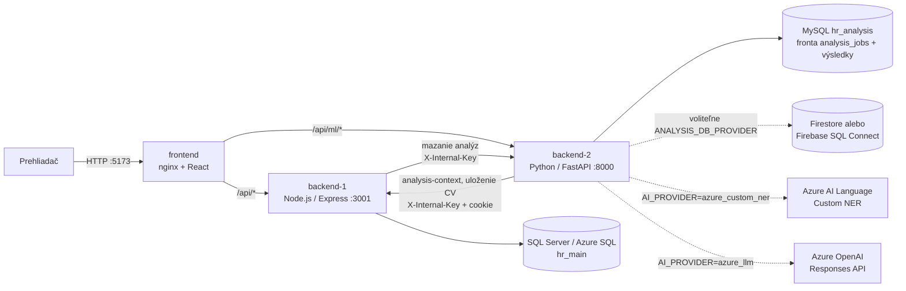

# Technický základ – SmartRecruit AI (HR systém)

Dokument vznikol analýzou repozitára (vetva `main`, commit `337c96d`). Uvádza iba to, čo vyplýva z kódu a konfigurácie; pri každom tvrdení je zdrojový súbor. Čo sa zistiť nedalo, je označené **NEZISTENÉ**. Hodnoty tajomstiev (heslá, kľúče, connection stringy) sa neuvádzajú, iba názvy premenných.

---

## 1. Účel aplikácie a hlavné funkcie

HR systém pre správu pracovných pozícií a prihlášok s automatickou analýzou životopisov (CV). Uchádzač sa prihlási na pozíciu a nahrá CV, systém z neho vyberie zručnosti a porovná ich s požiadavkami pozície. HR manažér vidí prihlášky so skóre zhody (`README.md`, úvod; `backend-2/app/nlp/pipeline.py`).

Hlavné funkcie podľa kódu:

| Funkcia | Zdroj |
|---|---|
| Registrácia (vždy rola `user`), prihlásenie, odhlásenie, úprava profilu, zmena hesla | `backend-1/src/routes/auth.js` |
| Verejný katalóg otvorených pozícií (po uzávierke sa nezobrazujú) | `backend-1/src/routes/jobs.js` |
| Podanie prihlášky so súhlasom GDPR (`consent_at`), jedna prihláška na pozíciu | `backend-1/src/routes/applications.js`, `database/azure-sql/schema.sql` |
| Stiahnutie prihlášky uchádzačom (stav `withdrawn`, zmazanie CV a analýzy) | `backend-1/src/routes/applications.js` |
| Nahratie CV (PDF/DOCX, limit `MAX_UPLOAD_MB`), asynchrónna analýza so stavmi úlohy a opakovaním | `backend-2/app/routers/ml.py`, `backend-2/app/analysis_jobs.py` |
| Extrakcia zručností, vzdelania, rokov praxe, mena a telefónu z CV | `backend-2/app/nlp/*` |
| Skóre = vážené pokrytie požadovaných zručností (`weighted-coverage-v1`) | `backend-2/app/nlp/pipeline.py` |
| HR: zoznam prihlášok s filtrom, zmena stavu, poznámky, história stavu, náhľad/stiahnutie CV | `backend-1/src/routes/admin.js` |
| HR: správa pozícií (vytvorenie, úprava) | `backend-1/src/routes/adminJobs.js` |
| Upozornenie pre HR, že má uchádzačovi poslať e-mail o zmene stavu (e-mail sa neodosiela automaticky) | `backend-1/src/routes/admin.js`, stĺpce `notify_status`, `notified_at` |
| GDPR: denné mazanie prihlášok starších ako `RETENTION_MONTHS` | `backend-1/src/services/retention.js` |
| Voliteľné poskytovatele AI: `local_rules`, `azure_custom_ner`, `azure_llm` | `backend-2/app/config.py`, `backend-2/app/nlp/providers.py`, `backend-2/app/nlp/azure_llm.py` |

Projekt je školský (predmet *Architektúra informačných systémov a prediktívna údržba*, `README.md`).

---

## 2. Použité technológie a verzie

| Časť | Technológia | Verzia | Zdroj |
|---|---|---|---|
| Backend 1 | Node.js (runtime v Dockeri) | 22 (`node:22-slim`); `engines`: `>=20` | `backend-1/Dockerfile`, `backend-1/package.json` |
| | Express | ^5.3.0 | `backend-1/package.json` |
| | express-session | ^1.19.0 | |
| | mssql (tedious) | ^12.7.6 | |
| | bcrypt, cors, dotenv | ^6.0.0, ^2.8.6, ^18.0.7 | |
| Backend 2 | Python | 3.12 (`python:3.12-slim`) | `backend-2/Dockerfile` |
| | FastAPI / uvicorn / pydantic | 0.146.0 / 0.54.0 / 2.14.1 | `backend-2/requirements.txt` |
| | spaCy + model `en_core_web_sm` | 3.8.16 (model bez pripnutej verzie) | `requirements.txt`, `Dockerfile` |
| | scikit-learn | 1.9.1 | |
| | pypdf / python-docx | 6.21.1 / 1.2.0 | |
| | mysql-connector-python | 26.7.0 | |
| | httpx | 0.28.1 | |
| | google-cloud-firestore | 2.34.1 | `backend-2/requirements-firestore.txt` |
| | pytest | 9.1.1 | `requirements.txt` |
| Frontend | React / react-dom | 18.3.1 | `frontend/package.json` |
| | react-router-dom | 6.28.0 | |
| | pdfjs-dist | 6.4.299 | |
| | Vite + @vitejs/plugin-react | 5.4.11 / 4.3.4 | |
| | nginx (produkčný server) | 1.27-alpine | `frontend/Dockerfile` |
| Databázy | SQL Server | 2022 (`mssql/server:2022-latest`) lokálne; Azure SQL Database v cloude | `docker-compose.yml`, `database/azure-sql/` |
| | MySQL | 8.0 | `docker-compose.yml` |
| | Firestore alebo Firebase SQL Connect (PostgreSQL) | voliteľné úložisko analýz | `docker-compose.firestore.yml`, `docker-compose.sqlconnect.yml`, `dataconnect/` |
| Kontajnerizácia | Docker Compose | verzia **NEZISTENÉ** (súbory nemajú pole `version`) | `docker-compose.yml` |
| Emulátor Firestore | Java 21 JRE (`eclipse-temurin:21-jre-alpine`), emulátor v1.22.0 | | `database/firestore/Dockerfile.emulator` |

Poznámka: `google-auth` a `requests` (používa `backend-2/app/sqlconnect_client.py`) nie sú v `requirements*.txt` uvedené priamo – prichádzajú ako závislosti `google-cloud-firestore` (inferencia, nie overené inštaláciou).

---

## 3. Architektúra

Zložky systému (`docker-compose.yml`, `frontend/nginx.conf`, `README.md`):

- **frontend** – React SPA servírovaná cez nginx; jediný vstupný bod pre prehliadač. Presmerováva `/api/ml/*` na Backend 2 a `/api/*` na Backend 1, takže session cookie funguje na jednom origin-e (`frontend/nginx.conf`, `frontend/vite.config.js`).
- **backend-1** (Node.js/Express) – používatelia, session, pozície, prihlášky, HR funkcie, uloženie súboru CV. Databáza: SQL Server / Azure SQL.
- **backend-2** (Python/FastAPI) – prijatie CV, rad úloh, NLP analýza, výsledky. Rad úloh je vždy v MySQL; výsledky analýz v MySQL, Firestore alebo SQL Connect podľa `ANALYSIS_DB_PROVIDER` (`backend-2/app/storage.py`).
- **Väzba medzi databázami** je `application_id`; nie je to cudzí kľúč, konzistenciu stráži aplikácia (`database/mysql/init.sql`).

Komunikácia medzi službami:

1. Prehliadač → Backend 1: prihlásenie, vytvorenie prihlášky.
2. Prehliadač → Backend 2 (`POST /api/ml/analyze`) s cookie `hr.sid`. Backend 2 si cez Backend 1 (`GET /api/internal/applications/:id/analysis-context`) overí session a vlastníctvo prihlášky a načíta požiadavky pozície zo servera, nie od klienta (`backend-2/app/routers/ml.py`, `backend-1/src/routes/internal.js`).
3. Backend 2 po spracovaní odošle súbor CV a kontakt do Backendu 1 (`PUT /api/internal/applications/:id/cv`, hlavička `X-Internal-Key`) (`backend-2/app/backend1.py`).
4. Worker v Backende 2 spracuje úlohu na pozadí; prehliadač sleduje stav (`/api/ml/status/{id}`) a načíta výsledok (`/api/ml/results/{id}`).
5. Backend 1 → Backend 2 (`POST /api/ml/internal/delete`, `X-Internal-Key`): mazanie analýz pri stiahnutí prihlášky a pri GDPR mazaní (`backend-1/src/services/backend2.js`).
6. Backend 2 → Azure (voliteľne): Azure AI Language (Custom NER) alebo Azure OpenAI Responses API (`backend-2/app/nlp/providers.py`, `azure_llm.py`).



---

## 4. Štruktúra projektu

```
AISPU_HR/
├── README.md                      – hlavný návod (spustenie, architektúra, stav)
├── .env.example                   – vzor konfigurácie (.env sa necommituje, je v .gitignore)
├── docker-compose.yml             – základný systém: mssql, mssql-init, mysql, backend-1, backend-2, frontend
├── docker-compose.firestore.yml   – prepínač Backendu 2 na online Firestore (override)
├── docker-compose.sqlconnect.yml  – prepínač na Firebase SQL Connect (override)
├── docker-compose.firestore-emulator.yml – lokálny Firestore emulátor pre testy (override)
├── firebase.json                  – konfigurácia Firebase (emulátor Data Connect, Firestore pravidlá)
├── backend-1/                     – Node.js / Express API
│   ├── Dockerfile
│   ├── package.json
│   ├── scripts/create-admin.js    – vytvorenie/povýšenie admin účtu
│   ├── src/
│   │   ├── server.js, app.js      – štart, middleware, montáž routov
│   │   ├── config/env.js          – načítanie a validácia premenných
│   │   ├── db/azureSql.js         – connection pool (mssql)
│   │   ├── middleware/            – auth (session/rola), internalAuth (X-Internal-Key), errorHandler
│   │   ├── routes/                – auth, jobs, applications, admin, adminJobs, internal
│   │   ├── services/              – backend2.js (volanie Backendu 2), retention.js (GDPR mazanie)
│   │   └── utils/                 – validate.js, jobInput.js, httpError.js
│   └── tests/analysis-context.test.js
├── backend-2/                     – Python / FastAPI
│   ├── Dockerfile, requirements.txt, requirements-firestore.txt, pytest.ini
│   ├── app/
│   │   ├── main.py, config.py     – aplikácia a konfigurácia/validácia AI
│   │   ├── routers/ml.py, internal.py
│   │   ├── analysis_jobs.py       – trvalý rad úloh v MySQL + worker
│   │   ├── db.py, repository.py   – MySQL
│   │   ├── firestore_*.py, sqlconnect_*.py – alternatívne úložiská
│   │   ├── backend1.py            – klient interného API Backendu 1
│   │   ├── nlp/                   – parser (PDF/DOCX), preprocess (spaCy), skills (slovník), extract, contact, matcher, providers, azure_llm, pipeline
│   │   ├── migrate_firestore.py, migrate_sqlconnect.py – migrácie dát
│   │   └── prepare_ner.py, evaluate_ner.py, azure_check.py – pomocné nástroje pre Azure NER
│   └── tests/                     – pytest (9 testovacích súborov)
├── frontend/                      – React + Vite
│   ├── Dockerfile, nginx.conf, vite.config.js
│   └── src/ (App.jsx, api.js, auth.jsx, labels.js, pages/, components/, styles.css)
├── database/
│   ├── azure-sql/schema.sql, deploy.ps1 – schéma T-SQL a nasadzovací skript pre Azure SQL
│   ├── mssql/init.sh, seed.sql    – inicializácia lokálneho SQL Servera
│   ├── mysql/init.sql             – schéma MySQL
│   └── firestore/                 – pravidlá, indexy, Dockerfile emulátora
├── dataconnect/                   – schéma a konektor Firebase SQL Connect (GraphQL)
├── docs/                          – dokumentácia fáz 1–5, Firebase, SQL Connect, BPMN, diagram.svg
└── sample-data/                   – vzorové CV (13 PDF + labels.csv), podklady pre Azure NER
```

---

## 5. Backend

### 5.1 Backend 1 – Node.js / Express (port 3001)

Zdroj: `backend-1/src/app.js`, `backend-1/src/routes/*.js`.

| Metóda | Cesta | Prístup | Účel |
|---|---|---|---|
| GET | `/health` | verejné | stav a kontrola DB |
| POST | `/api/auth/register` | verejné | registrácia (rola `user`) |
| POST | `/api/auth/login` | verejné | prihlásenie |
| POST | `/api/auth/logout` | – | odhlásenie |
| GET | `/api/auth/me` | prihlásený | aktuálny používateľ |
| PUT | `/api/auth/me` | prihlásený | úprava mena a telefónu |
| PUT | `/api/auth/me/password` | prihlásený | zmena hesla |
| GET | `/api/jobs`, `/api/jobs/:id` | verejné | otvorené pozície |
| GET | `/api/applications/mine` | prihlásený | vlastné prihlášky |
| POST | `/api/applications` | prihlásený | podanie prihlášky `{jobId, consent}` |
| POST | `/api/applications/:id/withdraw` | prihlásený (vlastník) | stiahnutie prihlášky |
| GET | `/api/applications/:id/history` | prihlásený (vlastník) | história stavu |
| GET | `/api/admin/applications` | admin | zoznam prihlášok (filter `status`, `jobId`) |
| PATCH | `/api/admin/applications/:id/status` | admin | zmena stavu |
| POST | `/api/admin/applications/:id/notified` | admin | označenie odoslaného e-mailu |
| GET | `/api/admin/applications/:id/cv` | admin | náhľad / `?download=1` stiahnutie CV |
| GET | `/api/admin/applications/:id/history` | admin | história stavu |
| GET, POST | `/api/admin/applications/:id/notes` | admin | poznámky HR |
| GET, POST | `/api/admin/jobs` | admin | zoznam všetkých pozícií / vytvorenie |
| PUT | `/api/admin/jobs/:id` | admin | úprava pozície |
| GET | `/api/internal/applications/:id/analysis-context` | `X-Internal-Key` + session cookie | požiadavky pozície pre Backend 2 |
| PUT | `/api/internal/applications/:id/cv` | `X-Internal-Key` + session cookie | uloženie CV a kontaktu |

**Autentifikácia:** server-side session (`express-session`), cookie `hr.sid`, `httpOnly`, `sameSite: lax`, `secure` iba pri `NODE_ENV=production`, platnosť 8 hodín (`app.js`). Heslá sa hashujú cez `bcrypt` (cost 12 v `create-admin.js`). Pri neexistujúcom e-maile sa aj tak porovnáva heslo (ochrana proti zisťovaniu účtov, `routes/auth.js`). Roly `user` a `admin`; `requireAuth`, `requireRole` (`middleware/auth.js`). Interné volania chráni `X-Internal-Key` porovnávaný v konštantnom čase (`middleware/internalAuth.js`).

**Spracovanie dát:** vstupy sa validujú ručne (`utils/validate.js`, `utils/jobInput.js`), SQL dotazy sú parametrizované (`db/azureSql.js`). Spojenie s DB je šifrované (`encrypt: true`). Chyby ide klientovi len bezpečná správa (`middleware/errorHandler.js`). Zmeny stavu sa zapisujú do histórie. Denný job maže prihlášky staršie ako `RETENTION_MONTHS` (najprv analýzy v Backende 2, potom riadky v SQL) (`services/retention.js`).

Stavy prihlášky: `submitted`, `reviewing`, `interview`, `accepted`, `rejected`, `withdrawn` (`schema.sql`). Stav `withdrawn` nastavuje iba uchádzač (`routes/admin.js`).

### 5.2 Backend 2 – Python / FastAPI (port 8000)

Zdroj: `backend-2/app/main.py`, `routers/ml.py`, `routers/internal.py`. Interaktívna dokumentácia API je na `/docs` (FastAPI; odkaz v `README.md`).

| Metóda | Cesta | Účel |
|---|---|---|
| GET | `/health` | stav DB a poskytovateľ úložiska |
| GET | `/api/ml/capabilities` | poskytovateľ AI, verzia skórovania, limit nahrávania |
| POST | `/api/ml/analyze` | nahratie CV (`file`, `application_id`); vracia 202 a zaradí úlohu |
| GET | `/api/ml/status/{application_id}` | stav úlohy (`queued`, `processing`, `completed`, `failed`, `not_started`) |
| POST | `/api/ml/retry/{application_id}` | opakovanie neúspešnej úlohy |
| GET | `/api/ml/results/{application_id}` | výsledok analýzy |
| POST | `/api/ml/internal/delete` | mazanie analýz (iba `X-Internal-Key`, skryté v dokumentácii) |

**Autorizácia:** všetky `/api/ml/*` okrem `capabilities` overujú session cookie `hr.sid` cez Backend 1 (`backend1.py`, `ml.py`). Požiadavky pozície klient neposiela.

**Spracovanie:** typ súboru sa zisťuje a text extrahuje v `nlp/parser.py` (PDF cez pypdf, DOCX cez python-docx), čistenie a spaCy v `nlp/preprocess.py` (limit 100 000 znakov). Rad úloh je tabuľka `analysis_jobs` v MySQL s atómovým prevzatím (`FOR UPDATE SKIP LOCKED`), 300 s prenájmom a max. 3 pokusmi (`analysis_jobs.py`). Worker beží vo vlákne pri štarte aplikácie (`ANALYSIS_WORKER_ENABLED`). Extrakcia zručností poskytovateľom: `local_rules` (slovník + spaCy EntityRuler, `nlp/skills.py`), `azure_custom_ner` alebo `azure_llm`. Skóre je vážené pokrytie požadovaných zručností (`score_percentage = skill_coverage`); textová podobnosť (TF-IDF kosínus, `nlp/matcher.py`) sa ukladá, ale do skóre nevstupuje (`pipeline.py`, riadok s `score_percentage=`). Pri `azure_llm` LLM iba vyberá zručnosti s presnými citáciami, skóre počíta aplikácia (`nlp/azure_llm.py`, `docs/faza-5-azure-llm.md`).

---

## 6. Frontend

React 18 + Vite, routing `react-router-dom` (`frontend/src/App.jsx`). Všetky volania API sú v `frontend/src/api.js`; stav prihláseného používateľa v `auth.jsx` (React context).

| Cesta | Stránka | Rola | Čo robí |
|---|---|---|---|
| `/login`, `/register` | `Login.jsx`, `Register.jsx` | všetci | prihlásenie a registrácia |
| `/jobs` | `Jobs.jsx` | všetci | katalóg pozícií |
| `/jobs/:id` | `JobDetail.jsx` | všetci (prihlásenie pri odoslaní) | detail, nahratie CV, súhlas GDPR, vytvorenie prihlášky a spustenie analýzy |
| `/my` | `MyApplications.jsx` | `user` | vlastné prihlášky, stav, história, stiahnutie |
| `/profile` | `Profile.jsx` | prihlásený | úprava profilu a hesla |
| `/admin` | `AdminApplications.jsx` | `admin` | prehľad prihlášok so skóre, filtre, detail analýzy, zmena stavu, poznámky, náhľad CV |
| `/admin/jobs` | `AdminJobs.jsx` | `admin` | správa pozícií |

Dôležité komponenty: `AnalysisDetail.jsx` (detail skóre a dôkazov), `OriginalCvDialog.jsx` (náhľad CV cez pdf.js), `NotesPanel.jsx`, `StatusHistory.jsx`, `RequireRole.jsx` (ochrana ciest), `FileDrop.jsx`. Ochrana ciest vo frontende je iba UX; skutočná autorizácia je v backendoch.

---

## 7. Dáta

### 7.1 SQL Server / Azure SQL – databáza `hr_main` (Backend 1)

Zdroj: `database/azure-sql/schema.sql` (idempotentný skript s migráciami).

| Tabuľka | Dôležité stĺpce | Vzťahy |
|---|---|---|
| `users` | `id`, `email` (UNIQUE), `password_hash`, `role` (`user`/`admin`), `full_name`, `phone`, `created_at` | – |
| `jobs` | `id`, `title`, `department`, `description`, `requirements` (text/JSON s váhami), `status` (`draft`/`open`/`closed`), `location`, `employment_type`, `work_mode`, `salary_min/max/period`, `responsibilities`, `benefits`, `published_at`, `deadline` | – |
| `applications` | `id`, `user_id`, `job_id`, `status`, `created_at`, `consent_at`, `candidate_name`, `candidate_phone`, `notify_status`, `notified_at` | FK → `users`, `jobs` (CASCADE); UNIQUE (`user_id`,`job_id`) |
| `application_cvs` | `application_id` (PK), `filename`, `content_type`, `size_bytes`, `data` VARBINARY(MAX), `uploaded_at` | FK → `applications` (CASCADE); povolené iba PDF a DOCX |
| `application_notes` | `id`, `application_id`, `author_id`, `text` (max 2000), `created_at` | FK → `applications` (CASCADE), `users` |
| `application_status_history` | `id`, `application_id`, `status`, `changed_by`, `changed_at` | FK → `applications` (CASCADE), `users` |

### 7.2 MySQL – databáza `hr_analysis` (Backend 2)

Zdroj: `database/mysql/init.sql`, `backend-2/app/db.py` (`ensure_schema`).

| Tabuľka | Obsah |
|---|---|
| `cv_analyses` | `application_id` (UNIQUE), `raw_text`, `skills_json`, `education_json`, `experience_years` |
| `match_scores` | `application_id`, `score_percentage`, `text_similarity`, `skill_coverage`, `matched_skills_json`, `missing_skills_json`, `analysis_json`, `analyzed_at` (história – viac riadkov na prihlášku) |
| `analysis_jobs` | fronta: `application_id` (PK), `state`, `payload_json` (obsahuje text CV), `provider`, `attempts`, `lock_token`, `lease_until`, `error_message`; vytvára ju aplikácia pri štarte, nie `init.sql` |

`application_id` odkazuje na `applications.id` v SQL Serveri bez cudzieho kľúča.

### 7.3 Alternatívne úložiská analýz

- **Firebase SQL Connect (PostgreSQL):** tabuľky `cv_analyses` (kľúč `applicationId`) a `analysis_runs` (`dataconnect/schema/schema.gql`); operácie `SaveAnalysis`, `DeleteAnalysis`, `ImportAnalysis`, `GetAnalysis`, `GetAnalysisHistory`, `ExportAnalysis`, `StorageHealth` (`dataconnect/hr-analysis/*.gql`).
- **Firestore:** pravidlá zakazujú všetok prístup z prehliadača (`database/firestore/firestore.rules`); indexy v `firestore.indexes.json`. Štruktúra kolekcií: pozri `backend-2/app/firestore_repository.py` (nepreskúmané do detailu).

---

## 8. Docker

### 8.1 Dockerfile

| Súbor | Popis |
|---|---|
| `backend-1/Dockerfile` | `node:22-slim`, `npm ci --omit=dev`, port 3001, `node src/server.js` |
| `backend-2/Dockerfile` | `python:3.12-slim`, inštalácia `requirements.txt`, stiahnutie modelu `en_core_web_sm`, potom vždy aj `requirements-firestore.txt`; port 8000, `uvicorn app.main:app` |
| `frontend/Dockerfile` | viacstupňový: `node:22-alpine` (`npm install`, `npm run build`) → `nginx:1.27-alpine` s `nginx.conf` a `dist`; port 80 |

### 8.2 `docker-compose.yml`

| Služba | Obraz / build | Port (host:kontajner) | Volumes | Poznámka |
|---|---|---|---|---|
| `mssql` | `mssql/server:2022-latest` (`linux/amd64`) | `${MSSQL_PORT:-1433}:1433` | `mssql_data` | healthcheck cez `sqlcmd` |
| `mssql-init` | rovnaký obraz | – | `./database:/scripts:ro` | jednorazovo vytvorí `hr_main`, aplikuje `schema.sql` a `seed.sql`, potom končí |
| `mysql` | `mysql:8.0` | `${MYSQL_PORT:-3306}:3306` | `mysql_data`, `database/mysql/init.sql` | healthcheck `mysqladmin ping` |
| `backend-1` | build `./backend-1` | 3001:3001 | – | čaká na `mssql-init` |
| `backend-2` | build `./backend-2` | 8000:8000 | – | čaká na zdravý `mysql` |
| `frontend` | build `./frontend` | 5173:80 | – | závisí od oboch backendov |

Pomenované volumes: `mssql_data`, `mysql_data`. Premenné služieb sú v kapitole 10. Override súbory (`docker-compose.firestore.yml`, `…sqlconnect.yml`, `…firestore-emulator.yml`) menia iba `backend-2`, prípadne pridávajú emulátor; kľúč servisného účtu sa pripája zo `./.secrets/firebase-admin.json` (priečinok je v `.gitignore`).

Backendy nemajú healthcheck a nenastavuje sa limit zdrojov (`docker-compose.yml`).

---

## 9. Azure

### 9.1 Použité služby

| Služba | Ako sa používa | Zdroj |
|---|---|---|
| **Azure SQL Database** | databáza Backendu 1 v cloude (Basic tier, región Switzerland North, predplatné Azure for Students podľa dokumentácie); schéma sa nasadzuje skriptom `deploy.ps1` (`sqlcmd`) | `docs/faza-1-databazy.md`, `database/azure-sql/deploy.ps1`, `backend-1/src/db/azureSql.js` |
| **Azure AI Language – Custom NER** | voliteľný poskytovateľ extrakcie zručností (`AI_PROVIDER=azure_custom_ner`); endpoint musí byť `*.cognitiveservices.azure.com` | `backend-2/app/config.py`, `nlp/providers.py`, `docs/faza-4-azure-ner.md` |
| **Azure OpenAI / Foundry – Responses API** | voliteľný poskytovateľ `azure_llm` (nasadenie `gpt-4.1-mini` podľa README); endpoint musí byť `*.openai.azure.com` alebo `*.services.ai.azure.com` | `backend-2/app/config.py`, `nlp/azure_llm.py`, `README.md` |

Predvolený poskytovateľ je `local_rules`, bez Azure (`.env.example`). Podľa dokumentácie pre aktuálny lokálny stroj Backend 1 stále používa lokálny SQL Server, nie online Azure SQL (`docs/firebase.md`, `docs/sqlconnect.md`).

### 9.2 Nasadenie, CI/CD, infraštruktúra

V repozitári **nie je** žiadny súbor Bicep, ARM, Terraform, GitHub Actions (`.github/` neexistuje) ani Azure DevOps pipeline. Jediný Azure „deployment“ artefakt je `database/azure-sql/deploy.ps1` (nasadí schému do už existujúcej databázy).

- Hosting aplikácie v Azure (App Service, Container Apps, AKS, VM…): **NEZISTENÉ**. V kóde sú len nepriame náznaky (`backend-1/src/app.js`: `trust proxy` „za reverznou proxy Azure“ pri `NODE_ENV=production`; `config/env.js`: „v cloude (App Service, kontajner) sa premenné nastavujú priamo“). Doplniť do sekcie 9 po rozhodnutí o hostingu.
- Container registry (ACR, Docker Hub): **NEZISTENÉ**.
- Vytvorenie Azure zdrojov: v `docs/faza-1-databazy.md` sú príkazy Azure CLI (`az sql server create`, `az sql db create`), ručne, nie ako kód v repozitári.
- Správa tajomstiev v cloude (Key Vault, App Settings): **NEZISTENÉ**.
- Firebase/Google Cloud (nie Azure) sa používa pre alternatívne úložisko analýz: projekt a služba sú nakonfigurované v `dataconnect/dataconnect.yaml`, `.env.example`.

---

## 10. Konfigurácia (premenné prostredia)

Zdroj: `.env.example`, `docker-compose.yml`, `backend-1/src/config/env.js`, `backend-2/app/config.py`. Lokálne sa číta spoločný `.env` v koreni; v Dockeri ich nastavuje compose. Skratka: **P** = povinná, **N** = nepovinná.

### Databázy a Docker

| Premenná | Účel | |
|---|---|---|
| `MSSQL_SA_PASSWORD` | heslo `sa` lokálneho SQL Servera (compose) | P (Docker) |
| `MSSQL_PORT`, `MYSQL_PORT` | porty publikované na hoste | N |
| `MYSQL_ROOT_PASSWORD` | root heslo MySQL (compose) | P (Docker) |
| `MYSQL_USER`, `MYSQL_PASSWORD` | účet Backendu 2 | P |
| `MYSQL_HOST`, `MYSQL_DATABASE` | adresa a názov DB (predvolene `localhost`, `hr_analysis`) | N |
| `AZURE_SQL_HOST` | server Backendu 1 | P |
| `AZURE_SQL_DATABASE`, `AZURE_SQL_USER`, `AZURE_SQL_PASSWORD` | DB a prihlasovacie údaje | P |
| `AZURE_SQL_PORT` | port (predvolene 1433) | N |
| `AZURE_SQL_TRUST_CERT` | `true` pre lokálny SQL Server so self-signed certifikátom | N |

### Backend 1

| Premenná | Účel | |
|---|---|---|
| `SESSION_SECRET` | podpis session cookie | P |
| `INTERNAL_API_KEY` | spoločný kľúč backendov pre interné API; bez neho vracia interné API 503 a CV sa neukladá | P pre plnú funkčnosť (spoločná s Backendom 2) |
| `BACKEND1_PORT` | port (3001) | N |
| `CORS_ORIGIN` | povolený origin (zdieľaná s Backendom 2, viac hodnôt čiarkou) | N |
| `BACKEND2_URL` | adresa Backendu 2 (mazanie analýz) | N |
| `RETENTION_MONTHS` | lehota GDPR mazania, predvolene 6 | N |
| `NODE_ENV` | `production` zapne `secure` cookie a `trust proxy` | N |

### Backend 2

| Premenná | Účel | |
|---|---|---|
| `BACKEND2_PORT`, `MAX_UPLOAD_MB` | port (8000), max. veľkosť CV (5) | N |
| `BACKEND1_URL` | adresa Backendu 1 | N |
| `ANALYSIS_DB_PROVIDER` | `mysql` / `firestore` / `sqlconnect` | N |
| `ANALYSIS_WORKER_ENABLED` | zapnutie workera (predvolene `true`) | N |
| `AI_PROVIDER` | `local_rules` / `azure_custom_ner` / `azure_llm` | N |
| `AZURE_OPENAI_ENDPOINT`, `AZURE_OPENAI_API_KEY`, `AZURE_OPENAI_DEPLOYMENT` | pripojenie na Azure LLM | P pri `azure_llm` |
| `AZURE_LLM_TIMEOUT_SECONDS`, `AZURE_LLM_MAX_CHARACTERS`, `AZURE_LLM_MAX_OUTPUT_TOKENS` | limity LLM | N |
| `AZURE_LANGUAGE_ENDPOINT`, `AZURE_LANGUAGE_KEY` | Azure AI Language | P pri `azure_custom_ner` |
| `AZURE_NER_PROJECT`, `AZURE_NER_DEPLOYMENT`, `AZURE_NER_MODEL_VERSION` | projekt, nasadenie, označenie verzie modelu | P pri `azure_custom_ner` |
| `AZURE_NER_LANGUAGE`, `AZURE_NER_SKILL_CATEGORIES`, `AZURE_NER_CONFIDENCE_THRESHOLD`, `AZURE_NER_TIMEOUT_SECONDS`, `AZURE_NER_MAX_CHARACTERS` | doplnkové nastavenia NER | N |
| `FIREBASE_PROJECT_ID` | projekt Firebase | P pri `firestore`/`sqlconnect` |
| `FIRESTORE_DATABASE_ID` | databáza Firestore (`(default)`) | N |
| `DATACONNECT_LOCATION`, `DATACONNECT_SERVICE_ID`, `DATACONNECT_CONNECTOR_ID` | SQL Connect | N |
| `DATA_CONNECT_EMULATOR_HOST`, `FIRESTORE_EMULATOR_HOST` | iba lokálne emulátory | N |
| `GOOGLE_APPLICATION_CREDENTIALS` | cesta k JSON kľúču servisného účtu (súbor sa necommituje) | P pri online Firebase |

### Frontend (iba vývoj)

| Premenná | Účel | |
|---|---|---|
| `BACKEND1_URL`, `BACKEND2_URL` | ciele Vite proxy (`frontend/vite.config.js`) | N |

---

## 11. Postup lokálneho spustenia a nasadenia

### 11.1 Cez Docker (odporúčané, podľa `README.md`)

1. Nainštalovať Docker Desktop (Mac s Apple čipom: zapnúť Rosettu kvôli SQL Serveru; Windows: WSL 2).
2. Stiahnuť repozitár.
3. Vytvoriť `.env` z `.env.example` (`copy .env.example .env`) a nastaviť aspoň `SESSION_SECRET`; pre interné API aj `INTERNAL_API_KEY` (rovnaká hodnota pre oba backendy). Hodnoty `MSSQL_SA_PASSWORD`, `MYSQL_*` majú v `.env.example` predvolené hodnoty.
4. `docker compose up -d --build` (prvé spustenie 5–10 minút).
5. Otvoriť `http://localhost:5173`. Testovacie účty a vzorové CV sú v `README.md` a `sample-data/cv/`.
6. Kontrola: `docker compose ps`, `docker compose logs -f <služba>`; `docker compose down -v` zmaže aj databázy.

Varianty úložiska analýz: `docker compose -f docker-compose.yml -f docker-compose.firestore.yml up -d --build` (potrebuje `.secrets/firebase-admin.json` a `FIREBASE_PROJECT_ID`, `docs/firebase.md`), obdobne `docker-compose.sqlconnect.yml` (`docs/sqlconnect.md`).

### 11.2 Bez Dockera s Azure SQL (podľa `README.md`)

1. `.env` s údajmi k Azure SQL; `docker compose up -d mysql` pre MySQL.
2. `powershell -File database\azure-sql\deploy.ps1` nasadí schému (vyžaduje `sqlcmd`).
3. Backend 1: `cd backend-1; npm install; npm run dev` (port 3001, `/health`).
4. Backend 2: vytvoriť venv, `pip install -r requirements.txt`, `python -m spacy download en_core_web_sm`, `uvicorn app.main:app --reload --port 8000`.
5. Frontend: `cd frontend; npm install; npm run dev` (port 5173).
6. Admin účet: `npm run create-admin -- <email> <heslo>` v `backend-1` (`scripts/create-admin.js`).

### 11.3 Testy

- Backend 2: `python -m pytest` (`docs/faza-3-backend-2.md`).
- Backend 1: `node --test` nad `tests/analysis-context.test.js` (test používa `node:test`; skript `npm test` v `package.json` **nie je**).

### 11.4 Nasadenie do Azure

Postup nasadenia aplikácie do Azure **NEZISTENÉ** – v repozitári nie je ani skript, ani pipeline (pozri 9.2). Nasadená je len databázová schéma cez `deploy.ps1`.

---

## 12. Zistené nedostatky a nejasnosti

**Rozpory medzi kódom a dokumentáciou**

1. `README.md` (tabuľka kontajnerov) uvádza skóre „0,6 × pokrytie zručností + 0,4 × podobnosť textu“, ale `pipeline.py` nastavuje `score_percentage` iba na vážené pokrytie; `matcher.final_score` (60/40) sa v pipeline nepoužíva. Vrchná časť README to uvádza správne.
2. `README.md` (sekcia „Čo ešte chýba“) a `frontend/README.md` označujú „Moje prihlášky“, správu pozícií a detail prihlášky ako chýbajúce, no `App.jsx` má stránky `MyApplications.jsx` a `AdminJobs.jsx`. Zoznam súborov vo `frontend/README.md` je neúplný.
3. `README.md` uvádza „5 kontajnerov“, `docker-compose.yml` definuje 6 služieb (vrátane jednorazového `mssql-init`). Štruktúra v README tiež uvádza dokumentáciu „fáz 1–3“, hoci v `docs/` sú fázy 1–5 a ďalšie.
4. `README.md` (riadok 181) odkazuje na `.bpmn` správne; odkaz na jeho SVG náhľad `docs/smartrecruit-proces.svg` je však nefunkčný, lebo súbor sa v `docs/` volá `diagram.svg` (je to export z bpmn-js). Stačí opraviť odkaz alebo súbor premenovať.
5. Pôvodný popis Docker architektúry v README nezmieňuje Firestore/SQL Connect režim; `backend-2/Dockerfile` však vždy inštaluje aj `requirements-firestore.txt`.
6. `docs/sqlconnect.md` uvádza, že stav „na tomto počítači“ riadi súkromný `.env` cez `COMPOSE_FILE`; to nie je reprodukovateľné z repozitára.
7. `.env.example` uvádza `AZURE_SQL_*` s Azure zástupnými hodnotami, pričom Docker compose ich prepisuje; pri práci len cez Docker sú `AZURE_SQL_*` v `.env` zbytočné.

**Testy**

8. Backend 1 má jediný test (`analysis-context.test.js`, 2 testy) a nemá skript `npm test`. Pokrytie routov (auth, aplikácie, admin) testmi **NEZISTENÉ** – nenájdené.
9. Frontend nemá žiadne testy ani linter.
10. Backend 2 má testy (9 testovacích súborov), ale 3 Firestore integračné testy sa preskakujú bez emulátora (`docs/sqlconnect.md`); `check_mysql_queue.py` v `tests/` nie je test, podľa názvu pomocný skript.
11. Spúšťanie testov nie je zapojené do žiadneho CI (žiadny pipeline súbor).

**Bezpečnosť a prevádzka**

12. Session sa ukladá do predvoleného `MemoryStore` (v `app.js` nie je nastavený `store`): po reštarte backendu sa prihlásenia stratia a pri viacerých inštanciách nefunguje. Pre produkciu nevhodné.
13. V kóde nebolo nájdené obmedzenie počtu pokusov o prihlásenie (rate limit), CSRF ochrana ani `helmet` (hľadané v `backend-1/src`, `backend-2/app`).
14. V Docker compose Backend 1 používa účet `sa` na SQL Serveri a databázy publikujú porty na host (1433, 3306); Backend 2 aj Backend 1 publikujú porty (3001, 8000) mimo nginx.
15. Obrazy `mssql/server:2022-latest` a model `en_core_web_sm` nie sú pripnuté na konkrétnu verziu; `frontend/Dockerfile` používa `npm install` namiesto `npm ci`.
16. Backendy v compose nemajú healthcheck ani nastavené limity zdrojov.
17. `.env.example` obsahuje predvolené heslá pre lokálnu DB a `README.md` zverejňuje testovacie účty s heslami; vhodné iba pre vývoj. Pri nasadení mimo lokálneho stroja je treba ich zmeniť.
18. `docs/faza-1-databazy.md` obsahuje identifikátory Azure zdrojov (server, resource group, login); v repozitári nemajú byť tajomstvá, ale zvážiť, či tieto údaje majú byť verejné.
19. `database/mssql/seed.sql` vkladá testovacích používateľov s hashmi hesiel – určené iba pre lokálny vývoj.

**Chýbajúce časti**

20. Chýba CI/CD, IaC a postup nasadenia do Azure (pozri 9.2).
21. Chýba súbor `LICENSE` v koreni; `backend-1/package.json` uvádza licenciu `ISC`. Verzia Docker Compose a minimálna verzia Dockeru **NEZISTENÉ**.
22. Trénovaný ML model nie je súčasťou projektu (`README.md`: skóre je NLP + pravidlá); Custom NER vyžaduje samostatné natrénovanie v Azure (`docs/faza-4-azure-ner.md`).
23. E-maily uchádzačom sa neodosielajú automaticky; systém iba upozorní HR (`routes/admin.js`).
24. Slovník zručností a spaCy model sú anglické; slovenčina je podporovaná len čiastočne (`nlp/skills.py`, `README.md`).
