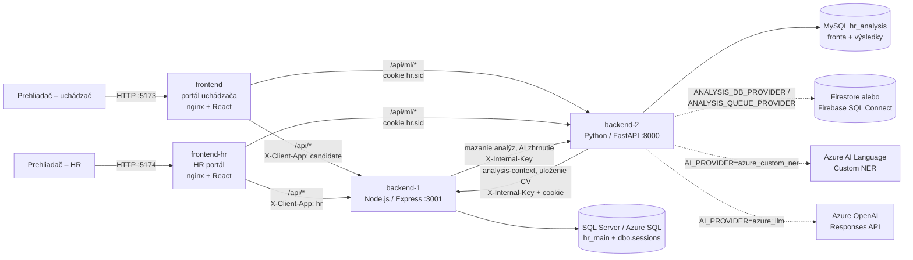

# Technický základ – SmartRecruit AI (HR systém)

Dokument vznikol analýzou repozitára (vetva `dva-frontendy`, commit `bdb0d67`, ktorý vychádza z `main` commit `0f1fdb7`). Uvádza iba to, čo vyplýva z kódu a konfigurácie; pri každom tvrdení je zdrojový súbor. Čo sa zistiť nedalo, je označené **NEZISTENÉ**. Hodnoty tajomstiev (heslá, kľúče, connection stringy) sa neuvádzajú, iba názvy premenných.

Oproti predchádzajúcej verzii (commit `337c96d`) pribudlo: rola správcu systému a správa rolí (PR #11), AI zhrnutie CV pre HR (PR #11), nasadenie na Azure App Service a fronta analýz vo Firestore (PR #10), dva samostatné frontendy a sessions uložené v SQL Serveri (vetva `dva-frontendy`).

---

## 1. Účel aplikácie a hlavné funkcie

HR systém pre správu pracovných pozícií a prihlášok s automatickou analýzou životopisov (CV). Uchádzač sa v portáli uchádzača prihlási na pozíciu a nahrá CV, systém z neho vyberie zručnosti a porovná ich s požiadavkami pozície. HR manažér v samostatnom HR portáli vidí prihlášky so skóre zhody (`README.md`, `backend-2/app/nlp/pipeline.py`, `docs/frontendy-a-sessions.md`).

Hlavné funkcie podľa kódu:

| Funkcia | Zdroj |
|---|---|
| Dva portály: portál uchádzača (rola `user`) a HR portál (roly `admin`, `sysadmin`), z jedného kódu | `frontend/src/main.jsx`, `frontend/src/apps/*.jsx` |
| Registrácia (vždy rola `user`, iba v portáli uchádzača), prihlásenie s kontrolou portálu, odhlásenie, úprava profilu, zmena hesla | `backend-1/src/routes/auth.js` |
| Verejný katalóg otvorených pozícií (po uzávierke sa nezobrazujú) | `backend-1/src/routes/jobs.js` |
| Podanie prihlášky so súhlasom GDPR (`consent_at`), jedna prihláška na pozíciu | `backend-1/src/routes/applications.js`, `database/azure-sql/schema.sql` |
| Stiahnutie prihlášky uchádzačom (stav `withdrawn`, zmazanie CV, AI zhrnutia a analýzy) | `backend-1/src/routes/applications.js` |
| Nahratie CV (PDF/DOCX, limit `MAX_UPLOAD_MB`), asynchrónna analýza so stavmi úlohy a opakovaním | `backend-2/app/routers/ml.py`, `backend-2/app/analysis_jobs.py`, `backend-2/app/firestore_jobs.py` |
| Extrakcia zručností, vzdelania, rokov praxe, mena a telefónu z CV | `backend-2/app/nlp/*` |
| Skóre = vážené pokrytie požadovaných zručností (`weighted-coverage-v1`) | `backend-2/app/nlp/pipeline.py` |
| AI zhrnutie CV voči pozícii pre HR (4 vety, bez odporúčania prijať/zamietnuť); uchádzač ho nevidí | `backend-2/app/nlp/azure_llm.py`, `backend-2/app/nlp/review_summary.py`, `backend-1/src/routes/reviewSummary.js`, `docs/ai-zhrnutie.md` |
| HR: zoznam prihlášok s filtrom, zmena stavu, poznámky, história stavu, náhľad/stiahnutie CV | `backend-1/src/routes/admin.js` |
| HR: správa pozícií (vytvorenie, úprava) | `backend-1/src/routes/adminJobs.js` |
| Správca systému: zoznam účtov, zmena rolí s auditom (`user_role_history`) | `backend-1/src/routes/system.js`, `docs/pouzivatelske-roly.md` |
| Upozornenie pre HR, že má uchádzačovi poslať e-mail o zmene stavu (e-mail sa neodosiela automaticky) | `backend-1/src/routes/admin.js`, stĺpce `notify_status`, `notified_at` |
| GDPR: denné mazanie prihlášok starších ako `RETENTION_MONTHS` | `backend-1/src/services/retention.js` |
| Voliteľní poskytovatelia AI: `local_rules`, `azure_custom_ner`, `azure_llm` | `backend-2/app/config.py`, `backend-2/app/nlp/providers.py`, `backend-2/app/nlp/azure_llm.py` |
| Svetlý/tmavý režim a SK/EN na prihlásení a registrácii | `frontend/src/preferences.jsx`, `components/DisplayPreferences.jsx`, `README.md` |

Projekt je školský (predmet *Architektúra informačných systémov a prediktívna údržba*, `README.md`).

---

## 2. Použité technológie a verzie

| Časť | Technológia | Verzia | Zdroj |
|---|---|---|---|
| Backend 1 | Node.js (runtime v Dockeri) | 22 (`node:22-slim`); `engines`: `>=20` | `backend-1/Dockerfile`, `backend-1/package.json` |
| | Express | ^5.3.0 | `backend-1/package.json` |
| | express-session (s vlastným úložiskom v SQL Serveri) | ^1.19.0 | `backend-1/src/db/sessionStore.js` |
| | mssql (tedious) | ^12.7.6 | |
| | bcrypt, cors, dotenv | ^6.0.0, ^2.8.6, ^18.0.7 | |
| Backend 2 | Python | 3.12 (`python:3.12-slim`) | `backend-2/Dockerfile` |
| | FastAPI / uvicorn / pydantic | 0.146.0 / 0.54.0 / 2.14.1 | `backend-2/requirements.txt` |
| | spaCy + model `en_core_web_sm` | 3.8.16; model v Dockeri bez pripnutej verzie, na Azure 3.8.0 | `requirements.txt`, `Dockerfile`, `requirements-azure.txt` |
| | scikit-learn | 1.9.1 | |
| | pypdf / python-docx | 6.21.1 / 1.2.0 | |
| | mysql-connector-python | 26.7.0 | |
| | httpx | 0.28.1 | |
| | google-cloud-firestore | 2.34.1 | `backend-2/requirements-firestore.txt`, `requirements-azure.txt` |
| | pytest | 9.1.1 | `requirements.txt` |
| Frontend | React / react-dom | 18.3.1 | `frontend/package.json` |
| | react-router-dom | 6.28.0 | |
| | pdfjs-dist | 6.4.299 | |
| | Vite + @vitejs/plugin-react | 5.4.11 / 4.3.4 | |
| | nginx (produkčný server v Dockeri) | 1.27-alpine | `frontend/Dockerfile` |
| | Node server pre Azure: express, http-proxy-middleware | ^5.1.0, ^3.0.5 | `frontend/azure/package.json` |
| Databázy | SQL Server | 2022 (`mssql/server:2022-latest`) lokálne; Azure SQL Database v cloude | `docker-compose.yml`, `database/azure-sql/` |
| | MySQL | 8.0 (lokálne) | `docker-compose.yml` |
| | Cloud Firestore | úložisko analýz aj fronty na Azure; voliteľne lokálne | `docs/azure-nasadenie.md`, `docker-compose.firestore.yml` |
| | Firebase SQL Connect (PostgreSQL) | voliteľné úložisko analýz | `docker-compose.sqlconnect.yml`, `dataconnect/` |
| Cloud | Azure App Service (Linux, plán F1) | – | `docs/azure-nasadenie.md`, `deploy/azure/deploy.sh` |
| Kontajnerizácia | Docker Compose | verzia **NEZISTENÉ** (súbory nemajú pole `version`) | `docker-compose.yml` |
| Emulátor Firestore | Java 21 JRE (`eclipse-temurin:21-jre-alpine`), emulátor v1.22.0 | | `database/firestore/Dockerfile.emulator` |

Poznámka: `google-auth` a `requests` (používa `backend-2/app/sqlconnect_client.py`) nie sú v `requirements*.txt` uvedené priamo – prichádzajú ako závislosti `google-cloud-firestore` (inferencia, nie overené inštaláciou).

---

## 3. Architektúra

Zložky systému (`docker-compose.yml`, `frontend/nginx.*.conf`, `docs/frontendy-a-sessions.md`):

- **frontend** (portál uchádzača, port 5173) a **frontend-hr** (HR portál, port 5174) – dve React SPA zostavené z toho istého kódu (`frontend/`, build-arg `APP=candidate|hr` → `VITE_APP`). Do buildu sa dostane iba aplikácia daného portálu. Každý portál servíruje vlastný nginx (`nginx.candidate.conf`, `nginx.hr.conf`), ktorý presmeruje `/api/ml/*` na Backend 2 a `/api/*` na Backend 1. Prehliadač tak volá jeden origin a session cookie funguje bez CORS. Na Azure robí to isté `frontend/azure/server.js`.
- **backend-1** (Node.js/Express) – používatelia, roly, session, pozície, prihlášky, HR funkcie, AI zhrnutie (koordinácia), uloženie súboru CV. Databáza: SQL Server / Azure SQL. Sessions sú v tabuľke `dbo.sessions`.
- **backend-2** (Python/FastAPI) – prijatie CV, rad úloh, NLP analýza, výsledky, generovanie AI zhrnutia. Výsledky analýz v MySQL, Firestore alebo SQL Connect podľa `ANALYSIS_DB_PROVIDER` (`backend-2/app/storage.py`). Rad úloh v MySQL alebo vo Firestore podľa `ANALYSIS_QUEUE_PROVIDER` (`backend-2/app/config.py`, `analysis_jobs.py`).
- **Väzba medzi databázami** je `application_id`; nie je to cudzí kľúč, konzistenciu stráži aplikácia (`database/mysql/init.sql`).

### 3.1 Oddelenie portálov a sessions

Proxy portálu pridá ku každej požiadavke na backend hlavičku `X-Client-App` (`candidate` alebo `hr`) a hodnotu z prehliadača prepíše. Backend 1 podľa nej vyberie cookie a povolené roly (`backend-1/src/middleware/session.js`, `routes/auth.js`):

| `X-Client-App` | Cookie | Kto sa smie prihlásiť |
|---|---|---|
| `candidate` | `sr.candidate.sid` | iba `user` (inak 403) |
| `hr` | `sr.hr.sid` | iba `admin`, `sysadmin` (inak 403) |
| chýba | `hr.sid` (iba interné volania z Backendu 2) | prihlásenie aj registrácia vrátia 400 |

Pri prihlásení sa do session zapíše aj portál (`clientApp`). `requireRole` pustí HR a správcovské endpointy iba so session z HR portálu (`middleware/auth.js`). Backend 2 preposiela session do Backendu 1 pod pevným menom `hr.sid` (`backend-2/app/backend1.py`), preto proxy portálu pri `/api/ml/*` premenuje cookie portálu na `hr.sid`. Všetky tri názvy ukazujú do toho istého úložiska `dbo.sessions`.

### 3.2 Komunikácia medzi službami

1. Prehliadač → portál → Backend 1: prihlásenie, vytvorenie prihlášky, HR funkcie.
2. Prehliadač → portál → Backend 2 (`POST /api/ml/analyze`) s cookie `hr.sid`. Backend 2 si cez Backend 1 (`GET /api/internal/applications/:id/analysis-context`) overí session a vlastníctvo prihlášky a načíta požiadavky a opis pozície zo servera, nie od klienta. Odpoveď obsahuje aj rolu (`viewerRole`) (`backend-2/app/routers/ml.py`, `backend-1/src/routes/internal.js`).
3. Backend 2 po spracovaní odošle súbor CV a kontakt do Backendu 1 (`PUT /api/internal/applications/:id/cv`, hlavička `X-Internal-Key`) (`backend-2/app/backend1.py`).
4. Worker v Backende 2 spracuje úlohu na pozadí; prehliadač sleduje stav (`/api/ml/status/{id}`) a načíta výsledok (`/api/ml/results/{id}`). Zaradenie novej úlohy workera hneď zobudí (`notify_worker`).
5. Backend 1 → Backend 2 (`POST /api/ml/internal/delete`, `X-Internal-Key`): mazanie analýz pri stiahnutí prihlášky a pri GDPR mazaní (`backend-1/src/services/backend2.js`).
6. Backend 1 → Backend 2 (`POST /api/ml/internal/review-summary/context|generate`, `X-Internal-Key`): AI zhrnutie pre HR (`backend-1/src/routes/reviewSummary.js`, `backend-2/app/routers/internal.py`).
7. Backend 2 → Azure (voliteľne): Azure AI Language (Custom NER) alebo Azure OpenAI Responses API (`backend-2/app/nlp/providers.py`, `azure_llm.py`, `review_summary.py`).



Na Azure (`docs/azure-nasadenie.md`): portály, Backend 1 a Backend 2 sú samostatné Web Apps, Backend 1 používa Azure SQL a Backend 2 používa Firestore pre výsledky aj frontu (MySQL nepotrebuje).

---

## 4. Štruktúra projektu

```
AISPU_HR/
├── README.md                      – hlavný návod (spustenie, portály, testovacie účty)
├── .env.example                   – vzor konfigurácie (.env sa necommituje, je v .gitignore)
├── docker-compose.yml             – základný systém: mssql, mssql-init, mysql, backend-1, backend-2, frontend, frontend-hr
├── docker-compose.firestore.yml   – prepínač Backendu 2 na online Firestore (override)
├── docker-compose.sqlconnect.yml  – prepínač na Firebase SQL Connect (override)
├── docker-compose.firestore-emulator.yml – lokálny Firestore emulátor pre testy (override)
├── firebase.json                  – konfigurácia Firebase (emulátor Data Connect, Firestore pravidlá)
├── deploy/azure/deploy.sh         – nasadenie kódu na Azure App Service (zip deploy cez az CLI)
├── backend-1/                     – Node.js / Express API
│   ├── Dockerfile
│   ├── package.json
│   ├── scripts/create-admin.js    – vytvorenie/povýšenie HR (admin) účtu
│   ├── scripts/create-system-admin.js – povýšenie existujúceho účtu na sysadmin
│   ├── src/
│   │   ├── server.js, app.js      – štart, middleware, montáž routov
│   │   ├── config/env.js          – načítanie a validácia premenných
│   │   ├── db/azureSql.js         – connection pool (mssql)
│   │   ├── db/sessionStore.js     – úložisko sessions v dbo.sessions
│   │   ├── middleware/            – session (výber cookie podľa portálu), auth (session/rola/portál), internalAuth (X-Internal-Key), errorHandler
│   │   ├── routes/                – auth, jobs, applications, admin, adminJobs, reviewSummary, system, internal
│   │   ├── services/              – backend2.js (volanie Backendu 2), retention.js (GDPR mazanie)
│   │   └── utils/                 – validate.js, jobInput.js, httpError.js
│   └── tests/                     – analysis-context, review-summary, system-roles (node:test)
├── backend-2/                     – Python / FastAPI
│   ├── Dockerfile, requirements.txt, requirements-firestore.txt, requirements-azure.txt, pytest.ini
│   ├── app/
│   │   ├── main.py, config.py     – aplikácia a konfigurácia/validácia AI a úložísk
│   │   ├── routers/ml.py, internal.py
│   │   ├── analysis_jobs.py       – trvalý rad úloh v MySQL + worker
│   │   ├── firestore_jobs.py      – rad úloh vo Firestore
│   │   ├── db.py, repository.py   – MySQL
│   │   ├── firestore_*.py, sqlconnect_*.py – alternatívne úložiská
│   │   ├── backend1.py            – klient interného API Backendu 1
│   │   ├── nlp/                   – parser (PDF/DOCX), preprocess (spaCy), skills (slovník), extract, contact, matcher, providers, azure_llm, review_summary, pipeline
│   │   ├── migrate_firestore.py, migrate_sqlconnect.py – migrácie dát
│   │   └── prepare_ner.py, evaluate_ner.py, azure_check.py – pomocné nástroje pre Azure NER
│   └── tests/                     – pytest (11 testovacích súborov)
├── frontend/                      – React + Vite, jeden kód pre dva portály
│   ├── Dockerfile (build-arg APP), nginx.candidate.conf, nginx.hr.conf, vite.config.js, .env.hr
│   ├── azure/                     – server.js (Node proxy pre App Service), package.json
│   └── src/
│       ├── main.jsx               – výber aplikácie podľa VITE_APP
│       ├── apps/CandidateApp.jsx, apps/HrApp.jsx – routy a navigácia portálov
│       ├── portal.js              – ktorý portál beží, adresy oboch portálov
│       ├── api.js, auth.jsx, preferences.jsx, labels.js
│       ├── pages/, components/    – spoločné obrazovky
│       └── styles.css, workspace.css
├── database/
│   ├── azure-sql/schema.sql, deploy.ps1 – schéma T-SQL a nasadzovací skript pre Azure SQL
│   ├── mssql/init.sh, seed.sql    – inicializácia lokálneho SQL Servera
│   ├── mysql/init.sql             – schéma MySQL
│   └── firestore/                 – pravidlá, indexy, Dockerfile emulátora
├── dataconnect/                   – schéma a konektor Firebase SQL Connect (GraphQL)
├── docs/                          – fázy 1–5, Firebase, SQL Connect, Azure nasadenie, roly, AI zhrnutie, frontendy a sessions, BPMN, diagram.svg, projektová dokumentácia (.docx)
└── sample-data/                   – vzorové CV (13 PDF + labels.csv), podklady pre Azure NER
```

---

## 5. Backend

### 5.1 Backend 1 – Node.js / Express (port 3001)

Zdroj: `backend-1/src/app.js`, `backend-1/src/routes/*.js`.

| Metóda | Cesta | Prístup | Účel |
|---|---|---|---|
| GET | `/health` | verejné | stav a kontrola DB |
| POST | `/api/auth/register` | verejné, iba portál uchádzača | registrácia (rola `user`) |
| POST | `/api/auth/login` | verejné, vyžaduje `X-Client-App` | prihlásenie; rola musí patriť do portálu |
| POST | `/api/auth/logout` | – | odhlásenie (zmaže cookie daného portálu) |
| GET | `/api/auth/me` | prihlásený | aktuálny používateľ |
| PUT | `/api/auth/me` | prihlásený | úprava mena a telefónu |
| PUT | `/api/auth/me/password` | prihlásený | zmena hesla |
| GET | `/api/jobs`, `/api/jobs/:id` | verejné | otvorené pozície |
| GET | `/api/applications/mine` | prihlásený | vlastné prihlášky |
| POST | `/api/applications` | prihlásený | podanie prihlášky `{jobId, consent}` |
| POST | `/api/applications/:id/withdraw` | prihlásený (vlastník) | stiahnutie prihlášky |
| GET | `/api/applications/:id/history` | prihlásený (vlastník) | história stavu |
| GET | `/api/admin/applications` | admin, HR portál | zoznam prihlášok (filter `status`, `jobId`) |
| PATCH | `/api/admin/applications/:id/status` | admin, HR portál | zmena stavu |
| POST | `/api/admin/applications/:id/notified` | admin, HR portál | označenie odoslaného e-mailu |
| GET | `/api/admin/applications/:id/cv` | admin, HR portál | náhľad / `?download=1` stiahnutie CV |
| GET | `/api/admin/applications/:id/history` | admin, HR portál | história stavu |
| GET, POST | `/api/admin/applications/:id/notes` | admin, HR portál | poznámky HR |
| GET, POST | `/api/admin/applications/:id/summary` | admin, HR portál | načítanie / vytvorenie AI zhrnutia |
| GET, POST | `/api/admin/jobs` | admin, HR portál | zoznam všetkých pozícií / vytvorenie |
| PUT | `/api/admin/jobs/:id` | admin, HR portál | úprava pozície |
| GET | `/api/system/users` | sysadmin, HR portál | zoznam účtov |
| GET | `/api/system/role-history` | sysadmin, HR portál | posledných 100 zmien rolí |
| PATCH | `/api/system/users/:id/role` | sysadmin, HR portál | zmena roly `{role, previousRole}` |
| GET | `/api/internal/applications/:id/analysis-context` | `X-Internal-Key` + session cookie | požiadavky a opis pozície, rola používateľa |
| PUT | `/api/internal/applications/:id/cv` | `X-Internal-Key` + session cookie | uloženie CV a kontaktu |

„admin“ znamená roly `admin` aj `sysadmin` (`requireRole` pustí sysadmina všade, kde stačí admin; `middleware/auth.js`).

**Autentifikácia a sessions:** server-side session (`express-session`), uložená v tabuľke `dbo.sessions` cez vlastné úložisko `MssqlSessionStore` (`db/sessionStore.js`). Sessions tak prežijú reštart Backendu 1 a zdieľajú ich všetky inštancie. Exspirované sa pri čítaní ignorujú a každých 15 minút sa mažú. Cookie podľa portálu (`sr.candidate.sid`, `sr.hr.sid`, interne `hr.sid`; pozri 3.1), `httpOnly`, `sameSite: lax`, `secure` iba pri `NODE_ENV=production`, platnosť 8 hodín (`middleware/session.js`). Pri prihlásení a zmene hesla vzniká nové ID session (`routes/auth.js`, ochrana pred session fixation). Rola sa pri každej požiadavke na `/api/*` znova načíta z DB, takže odobratá rola platí hneď (`refreshSessionRole`, `middleware/auth.js`). Heslá sa hashujú cez `bcrypt` (cost 12). Pri neexistujúcom e-maile sa aj tak porovnáva heslo; rola sa kontroluje až po správnom hesle (ochrana proti zisťovaniu účtov, `routes/auth.js`). Interné volania chráni `X-Internal-Key` porovnávaný v konštantnom čase (`middleware/internalAuth.js`).

**Roly:** `user` (uchádzač), `admin` (HR manažér), `sysadmin` (správca systému) (`schema.sql`, `CK_users_role`). Zmena roly beží v jednej transakcii so zámkom `sp_getapplock`, overí aktuálnu rolu (`previousRole`), zakáže zmenu vlastnej roly a odobratie posledného správcu a zapíše audit do `user_role_history` (`routes/system.js`). Prvého správcu vytvorí `npm run create-system-admin -- <email>` (`scripts/create-system-admin.js`, `docs/pouzivatelske-roly.md`).

**AI zhrnutie:** Backend 1 si od Backendu 2 vyžiada odtlačok analýzy (`fingerprint`). Ak už analýza zhrnutie obsahuje, vráti ho. Inak krátkou SQL transakciou zaberie prácu (stav `processing`, 5-minútový lease), zavolá generovanie bez držania zámkov a výsledok uloží do `application_review_summaries` (`routes/reviewSummary.js`, `docs/ai-zhrnutie.md`).

**Spracovanie dát:** vstupy sa validujú ručne (`utils/validate.js`, `utils/jobInput.js`), SQL dotazy sú parametrizované (`db/azureSql.js`). Spojenie s DB je šifrované (`encrypt: true`). Klientovi ide pri chybe len bezpečná správa (`middleware/errorHandler.js`). Zmeny stavu sa zapisujú do histórie. Denný job maže prihlášky staršie ako `RETENTION_MONTHS` (najprv analýzy v Backende 2, potom riadky v SQL) (`services/retention.js`).

Stavy prihlášky: `submitted`, `reviewing`, `interview`, `accepted`, `rejected`, `withdrawn` (`schema.sql`). Stav `withdrawn` nastavuje iba uchádzač (`routes/admin.js`).

### 5.2 Backend 2 – Python / FastAPI (port 8000)

Zdroj: `backend-2/app/main.py`, `routers/ml.py`, `routers/internal.py`. Interaktívna dokumentácia API je na `/docs` (FastAPI).

| Metóda | Cesta | Účel |
|---|---|---|
| GET | `/health` | stav DB a poskytovateľ úložiska |
| GET | `/api/ml/capabilities` | poskytovateľ AI, verzia skórovania, limit nahrávania |
| POST | `/api/ml/analyze` | nahratie CV (`file`, `application_id`); vracia 202 a zaradí úlohu (413 pri príliš veľkom payloade) |
| GET | `/api/ml/status/{application_id}` | stav úlohy (`queued`, `processing`, `completed`, `failed`, `not_started`) |
| POST | `/api/ml/retry/{application_id}` | opakovanie neúspešnej úlohy |
| GET | `/api/ml/results/{application_id}` | výsledok analýzy; AI zhrnutie iba pre `admin`/`sysadmin` |
| POST | `/api/ml/internal/delete` | mazanie analýz (iba `X-Internal-Key`, skryté v dokumentácii) |
| POST | `/api/ml/internal/review-summary/context` | odtlačok analýzy a prípadné uložené zhrnutie (`X-Internal-Key`) |
| POST | `/api/ml/internal/review-summary/generate` | vytvorenie AI zhrnutia (`X-Internal-Key`) |

**Autorizácia:** všetky `/api/ml/*` okrem `capabilities` a interných overujú session cookie `hr.sid` cez Backend 1 (`backend1.py`, `ml.py`). Požiadavky pozície klient neposiela.

**Spracovanie:** typ súboru sa zisťuje a text extrahuje v `nlp/parser.py` (PDF cez pypdf, DOCX cez python-docx), čistenie a spaCy v `nlp/preprocess.py` (limit 100 000 znakov). Rad úloh (`analysis_jobs`) je v MySQL s atómovým prevzatím (`FOR UPDATE SKIP LOCKED`) alebo vo Firestore (`firestore_jobs.py`, transakcia, payload komprimovaný gzip, max. 900 000 B). V oboch variantoch platí 300 s prenájom a max. 3 pokusy. Worker beží vo vlákne pri štarte aplikácie (`ANALYSIS_WORKER_ENABLED`); prázdnu frontu kontroluje každú 1 s (MySQL) alebo 30 s (Firestore, kvôli kvóte čítaní) a nová úloha ho zobudí okamžite (`analysis_jobs.py`).

Extrakcia zručností poskytovateľom: `local_rules` (slovník + spaCy EntityRuler, `nlp/skills.py`), `azure_custom_ner` alebo `azure_llm`. Skóre je vážené pokrytie požadovaných zručností (`score_percentage = skill_coverage`); textová podobnosť (TF-IDF kosínus, `nlp/matcher.py`) sa ukladá, ale do skóre nevstupuje (`pipeline.py`). Pri `azure_llm` dostane model celé CV aj opis pozície a v jednom volaní vráti zručnosti s presnými citáciami a štyri vety zhrnutia pre HR; skóre počíta aplikácia (`nlp/azure_llm.py`, `docs/ai-zhrnutie.md`). Zhrnutie sa ukladá v `analysis_metadata.review_summary`, opis pozície v `position_snapshot`. Pre staršie analýzy sa dá zhrnutie vytvoriť dodatočne (`nlp/review_summary.py`, limit 650 výstupných tokenov). Pri inom poskytovateľovi vznikne označený pravidlový prehľad bez volania LLM.

---

## 6. Frontend

React 18 + Vite, routing `react-router-dom`. Jeden kód, dve aplikácie: `src/main.jsx` vyberie `CandidateApp` alebo `HrApp` podľa `VITE_APP`, ktoré Vite pri zostavení nahradí konštantou, takže druhá aplikácia sa do buildu nedostane. Všetky volania API sú v `frontend/src/api.js`; stav prihláseného používateľa v `auth.jsx`, nastavenia zobrazenia v `preferences.jsx` (React context). Hlavičku `X-Client-App` neposiela prehliadač, ale proxy (nginx, Vite, `azure/server.js`).

### 6.1 Portál uchádzača (`apps/CandidateApp.jsx`, port 5173)

| Cesta | Stránka | Rola | Čo robí |
|---|---|---|---|
| `/login`, `/register` | `Login.jsx`, `Register.jsx` | všetci | prihlásenie a registrácia |
| `/jobs` | `Jobs.jsx` | všetci | katalóg pozícií |
| `/jobs/:id` | `JobDetail.jsx` | všetci (prihlásenie pri odoslaní) | detail, nahratie CV, súhlas GDPR, vytvorenie prihlášky a spustenie analýzy |
| `/my` | `MyApplications.jsx` | `user` | vlastné prihlášky, stav, história, stiahnutie |
| `/profile` | `Profile.jsx` | prihlásený | úprava profilu a hesla |

### 6.2 HR portál (`apps/HrApp.jsx`, port 5174)

| Cesta | Stránka | Rola | Čo robí |
|---|---|---|---|
| `/login` | `Login.jsx` | všetci | prihlásenie (registrácia tu nie je, `/register` presmeruje na `/login`) |
| `/applications` | `AdminApplications.jsx` | `admin`, `sysadmin` | prehľad prihlášok so skóre, filtre, detail analýzy, AI zhrnutie, zmena stavu, poznámky, náhľad CV |
| `/jobs` | `AdminJobs.jsx` | `admin`, `sysadmin` | správa pozícií |
| `/users` | `SystemUsers.jsx` | `sysadmin` | účty, zmena rolí, história oprávnení |
| `/profile` | `Profile.jsx` | prihlásený | úprava profilu a hesla |

Odkazy medzi portálmi („Prejsť do HR portálu“, „Verejné ponuky“) sa tvoria z `VITE_HR_URL` a `VITE_CANDIDATE_URL` (predvolene `localhost`, `src/portal.js`).

Dôležité komponenty: `AnalysisDetail.jsx` (detail skóre a dôkazov), `ReviewSummary.jsx` (AI zhrnutie), `OriginalCvDialog.jsx` (náhľad CV cez pdf.js), `NotesPanel.jsx`, `StatusHistory.jsx`, `RequireRole.jsx` (ochrana ciest a kontrola, či účet patrí do portálu), `Layout.jsx` (navigáciu dostane ako parameter), `DisplayPreferences.jsx`, `FileDrop.jsx`. Ochrana ciest vo frontende je iba UX; skutočná autorizácia je v backendoch.

---

## 7. Dáta

### 7.1 SQL Server / Azure SQL – databáza `hr_main` (Backend 1)

Zdroj: `database/azure-sql/schema.sql` (idempotentný skript s migráciami).

| Tabuľka | Dôležité stĺpce | Vzťahy |
|---|---|---|
| `users` | `id`, `email` (UNIQUE), `password_hash`, `role` (`user`/`admin`/`sysadmin`), `full_name`, `phone`, `created_at` | – |
| `jobs` | `id`, `title`, `department`, `description`, `requirements` (text/JSON s váhami), `status` (`draft`/`open`/`closed`), `location`, `employment_type`, `work_mode`, `salary_min/max/period`, `responsibilities`, `benefits`, `published_at`, `deadline` | – |
| `applications` | `id`, `user_id`, `job_id`, `status`, `created_at`, `consent_at`, `candidate_name`, `candidate_phone`, `notify_status`, `notified_at` | FK → `users`, `jobs` (CASCADE); UNIQUE (`user_id`,`job_id`) |
| `application_cvs` | `application_id` (PK), `filename`, `content_type`, `size_bytes`, `data` VARBINARY(MAX), `uploaded_at` | FK → `applications` (CASCADE); povolené iba PDF a DOCX |
| `application_notes` | `id`, `application_id`, `author_id`, `text` (max 2000), `created_at` | FK → `applications` (CASCADE), `users` |
| `application_status_history` | `id`, `application_id`, `status`, `changed_by`, `changed_at` | FK → `applications` (CASCADE), `users` |
| `user_role_history` | `id`, `user_id`, `previous_role`, `new_role`, `changed_by` (NULL = príkazový riadok), `changed_at` | FK → `users` |
| `application_review_summaries` | `application_id` (PK), `fingerprint` CHAR(64), `state` (`processing`/`ready`/`failed`), `payload_json`, `lock_token`, `lease_until` | FK → `applications` (CASCADE) |
| `sessions` | `sid` (PK), `session` (JSON: `userId`, `role`, `clientApp`, cookie), `expires` (UTC, index) | – |

Na Azure SQL sú ID prihlášok preseedované od 10001 (`DBCC CHECKIDENT`), aby sa nebili s lokálnymi inštanciami, ktoré zdieľajú ten istý Firestore (`docs/azure-nasadenie.md`).

### 7.2 MySQL – databáza `hr_analysis` (Backend 2)

Zdroj: `database/mysql/init.sql`, `backend-2/app/db.py` (`ensure_schema`). Používa sa iba, ak `ANALYSIS_DB_PROVIDER=mysql` alebo `ANALYSIS_QUEUE_PROVIDER=mysql` (`config.py`).

| Tabuľka | Obsah |
|---|---|
| `cv_analyses` | `application_id` (UNIQUE), `raw_text`, `skills_json`, `education_json`, `experience_years` |
| `match_scores` | `application_id`, `score_percentage`, `text_similarity`, `skill_coverage`, `matched_skills_json`, `missing_skills_json`, `analysis_json`, `analyzed_at` (história – viac riadkov na prihlášku) |
| `analysis_jobs` | fronta: `application_id` (PK), `state`, `payload_json` (obsahuje text CV), `provider`, `attempts`, `lock_token`, `lease_until`, `error_message`; vytvára ju aplikácia pri štarte, nie `init.sql` |

`application_id` odkazuje na `applications.id` v SQL Serveri bez cudzieho kľúča.

### 7.3 Firestore a ďalšie úložiská analýz

- **Firestore:** kolekcia `cv_analyses/{application_id}` s podkolekciou `history` a pri `ANALYSIS_QUEUE_PROVIDER=firestore` aj `analysis_jobs/{application_id}` (výber úlohy jedným dotazom `lease_until <= teraz`, stačí automatický jednopoľový index) (`firestore_repository.py`, `firestore_jobs.py`). Pravidlá zakazujú všetok prístup z prehliadača (`database/firestore/firestore.rules`); indexy v `firestore.indexes.json`. Na Azure sa používa Firebase projekt uvedený v `docs/azure-nasadenie.md`, databáza `(default)` je zdieľaná s lokálnymi inštanciami.
- **Firebase SQL Connect (PostgreSQL):** tabuľky `cv_analyses` (kľúč `applicationId`) a `analysis_runs` (`dataconnect/schema/schema.gql`); operácie `SaveAnalysis`, `DeleteAnalysis`, `ImportAnalysis`, `GetAnalysis`, `GetAnalysisHistory`, `ExportAnalysis`, `StorageHealth` (`dataconnect/hr-analysis/*.gql`). Fronta zostáva v MySQL (`config.py`: Firestore fronta vyžaduje `ANALYSIS_DB_PROVIDER=firestore`).

---

## 8. Docker

### 8.1 Dockerfile

| Súbor | Popis |
|---|---|
| `backend-1/Dockerfile` | `node:22-slim`, `npm ci --omit=dev`, port 3001, `node src/server.js` |
| `backend-2/Dockerfile` | `python:3.12-slim`, inštalácia `requirements.txt`, stiahnutie modelu `en_core_web_sm`, potom vždy aj `requirements-firestore.txt`; port 8000, `uvicorn app.main:app` |
| `frontend/Dockerfile` | jeden súbor pre oba portály, build-arg `APP` (`candidate`/`hr`); viacstupňový: `node:22-alpine` (`npm install`, `VITE_APP=$APP npm run build`) → `nginx:1.27-alpine` s `nginx.${APP}.conf` a `dist`; port 80 |

### 8.2 `docker-compose.yml`

| Služba | Obraz / build | Port (host:kontajner) | Volumes | Poznámka |
|---|---|---|---|---|
| `mssql` | `mssql/server:2022-latest` (`linux/amd64`) | `${MSSQL_PORT:-1433}:1433` | `mssql_data` | healthcheck cez `sqlcmd` |
| `mssql-init` | rovnaký obraz | – | `./database:/scripts:ro` | jednorazovo vytvorí `hr_main`, aplikuje `schema.sql` a `seed.sql`, potom končí |
| `mysql` | `mysql:8.0` | `${MYSQL_PORT:-3306}:3306` | `mysql_data`, `database/mysql/init.sql` | healthcheck `mysqladmin ping` |
| `backend-1` | build `./backend-1` | 3001:3001 | – | čaká na `mssql-init`; `CORS_ORIGIN` obsahuje oba portály |
| `backend-2` | build `./backend-2` | 8000:8000 | – | čaká na zdravý `mysql` |
| `frontend` | build `./frontend`, `APP=candidate` | 5173:80 | – | portál uchádzača, závisí od oboch backendov |
| `frontend-hr` | build `./frontend`, `APP=hr` | 5174:80 | – | HR portál, závisí od oboch backendov |

Pomenované volumes: `mssql_data`, `mysql_data`. Premenné služieb sú v kapitole 10. Override súbory (`docker-compose.firestore.yml`, `…sqlconnect.yml`, `…firestore-emulator.yml`) menia iba `backend-2`, prípadne pridávajú emulátor; kľúč servisného účtu sa pripája zo `./.secrets/firebase-admin.json` (priečinok je v `.gitignore`). `ANALYSIS_QUEUE_PROVIDER` v žiadnom compose súbore nie je nastavená, v Dockeri je teda fronta vždy v MySQL.

Backendy nemajú healthcheck a nenastavuje sa limit zdrojov (`docker-compose.yml`).

---

## 9. Azure

### 9.1 Použité služby

| Služba | Ako sa používa | Zdroj |
|---|---|---|
| **Azure App Service** (Linux, plán F1 Free, Switzerland North) | hosting portálu uchádzača, Backendu 1 a Backendu 2 ako tri Web Apps; HR portál ako štvrtá Web App je pripravený, ale zatiaľ nenasadený | `docs/azure-nasadenie.md`, `deploy/azure/deploy.sh` |
| **Azure SQL Database** | databáza Backendu 1 vrátane `dbo.sessions` (Basic tier); schéma sa nasadzuje skriptom `deploy.ps1` (`sqlcmd`) | `docs/faza-1-databazy.md`, `docs/azure-nasadenie.md`, `database/azure-sql/deploy.ps1` |
| **Azure AI Language – Custom NER** | voliteľný poskytovateľ extrakcie zručností (`AI_PROVIDER=azure_custom_ner`); endpoint musí byť `*.cognitiveservices.azure.com` | `backend-2/app/config.py`, `nlp/providers.py`, `docs/faza-4-azure-ner.md` |
| **Azure OpenAI / Foundry – Responses API** | voliteľný poskytovateľ `azure_llm` (nasadenie `gpt-4.1-mini`) pre zručnosti aj AI zhrnutie; endpoint musí byť `*.openai.azure.com` alebo `*.services.ai.azure.com` | `backend-2/app/config.py`, `nlp/azure_llm.py`, `nlp/review_summary.py` |

Mimo Azure: **Firebase / Cloud Firestore** (plán Spark) je databáza Backendu 2 v cloude (výsledky analýz aj fronta) (`docs/azure-nasadenie.md`). V nasadení je nastavené `AI_PROVIDER=local_rules`.

### 9.2 Nasadenie a infraštruktúra

- **Hosting:** Web Apps na App Service, plán F1 (60 CPU minút denne, 1 GB RAM, bez Always On; aplikácie po ~20 minútach nečinnosti zaspia) (`docs/azure-nasadenie.md`).
- **Frontend na Azure:** na App Service nebeží nginx; `frontend/azure/server.js` (Express + http-proxy-middleware) servíruje `dist/`, presmeruje `/api/ml` a `/api`, pridá `X-Client-App` podľa `CLIENT_APP` a pri `/api/ml` premenuje cookie na `hr.sid`.
- **Nasadenie kódu:** `bash deploy/azure/deploy.sh [frontend|backend-1|backend-2]` zabalí zip a nahrá ho cez `az webapp deploy`. Závislosti Backendu 1 a 2 zostaví Azure (Oryx); pre Backend 2 sa `requirements-azure.txt` zabalí ako `requirements.txt` (`deploy/azure/deploy.sh`). Skript zatiaľ nasadzuje iba portál uchádzača.
- **Vytvorenie Azure zdrojov:** ručne cez Azure CLI (`docs/faza-1-databazy.md`), nie ako kód v repozitári. V repozitári **nie je** Bicep, ARM, Terraform, GitHub Actions (`.github/` neexistuje) ani Azure DevOps pipeline.
- **Tajomstvá v cloude:** iba v App settings jednotlivých Web Apps a v ignorovanom `.secrets/`; Firebase kľúč je súbor `/home/secrets/firebase-admin.json` mimo `wwwroot` vo Web App Backendu 2 (`docs/azure-nasadenie.md`). Key Vault sa nepoužíva (nenájdený v kóde ani dokumentácii).
- **Container registry:** nepoužíva sa, nasadzuje sa kód (zip), nie Docker obrazy.
- **Sieť:** backendy majú verejnú adresu (F1 nemá privátnu sieť); chráni ich session a `X-Internal-Key` (`docs/azure-nasadenie.md`).

---

## 10. Konfigurácia (premenné prostredia)

Zdroj: `.env.example`, `docker-compose.yml`, `backend-1/src/config/env.js`, `backend-2/app/config.py`, `frontend/vite.config.js`, `frontend/azure/server.js`, `frontend/src/portal.js`. Lokálne sa číta spoločný `.env` v koreni; v Dockeri ich nastavuje compose, na Azure App settings. Skratka: **P** = povinná, **N** = nepovinná.

### Databázy a Docker

| Premenná | Účel | |
|---|---|---|
| `MSSQL_SA_PASSWORD` | heslo `sa` lokálneho SQL Servera (compose) | P (Docker) |
| `MSSQL_PORT`, `MYSQL_PORT` | porty publikované na hoste | N |
| `MYSQL_ROOT_PASSWORD` | root heslo MySQL (compose) | P (Docker) |
| `MYSQL_USER`, `MYSQL_PASSWORD` | účet Backendu 2 | P, ak sa používa MySQL |
| `MYSQL_HOST`, `MYSQL_DATABASE` | adresa a názov DB (predvolene `localhost`, `hr_analysis`) | N |
| `AZURE_SQL_HOST` | server Backendu 1 | P |
| `AZURE_SQL_DATABASE`, `AZURE_SQL_USER`, `AZURE_SQL_PASSWORD` | DB a prihlasovacie údaje | P |
| `AZURE_SQL_PORT` | port (predvolene 1433) | N |
| `AZURE_SQL_TRUST_CERT` | `true` pre lokálny SQL Server so self-signed certifikátom | N |

### Backend 1

| Premenná | Účel | |
|---|---|---|
| `SESSION_SECRET` | podpis session cookies (spoločný pre všetky portály) | P |
| `INTERNAL_API_KEY` | spoločný kľúč backendov pre interné API; bez neho vracia interné API 503, CV sa neukladá a AI zhrnutie nefunguje | P pre plnú funkčnosť (spoločná s Backendom 2) |
| `BACKEND1_PORT` | port (3001; na Azure 8080) | N |
| `CORS_ORIGIN` | povolené originy, viac hodnôt čiarkou (predvolene `http://localhost:5173,http://localhost:5174`; zdieľaná s Backendom 2) | N |
| `BACKEND2_URL` | adresa Backendu 2 (mazanie analýz, AI zhrnutie) | N |
| `RETENTION_MONTHS` | lehota GDPR mazania, predvolene 6 | N |
| `NODE_ENV` | `production` zapne `secure` cookie a `trust proxy` | N |

### Backend 2

| Premenná | Účel | |
|---|---|---|
| `BACKEND2_PORT`, `MAX_UPLOAD_MB` | port (8000), max. veľkosť CV (5) | N |
| `BACKEND1_URL` | adresa Backendu 1 | N |
| `ANALYSIS_DB_PROVIDER` | výsledky analýz: `mysql` / `firestore` / `sqlconnect` | N |
| `ANALYSIS_QUEUE_PROVIDER` | fronta analýz: `mysql` / `firestore` (`firestore` iba s `ANALYSIS_DB_PROVIDER=firestore`; vtedy MySQL netreba) | N |
| `ANALYSIS_WORKER_ENABLED` | zapnutie workera (predvolene `true`) | N |
| `AI_PROVIDER` | `local_rules` / `azure_custom_ner` / `azure_llm` | N |
| `AZURE_OPENAI_ENDPOINT`, `AZURE_OPENAI_API_KEY`, `AZURE_OPENAI_DEPLOYMENT` | pripojenie na Azure LLM | P pri `azure_llm` |
| `AZURE_LLM_TIMEOUT_SECONDS`, `AZURE_LLM_MAX_CHARACTERS`, `AZURE_LLM_MAX_OUTPUT_TOKENS` | limity LLM (spoločný vstup CV + pozícia, výstup vrátane zhrnutia) | N |
| `AZURE_LANGUAGE_ENDPOINT`, `AZURE_LANGUAGE_KEY` | Azure AI Language | P pri `azure_custom_ner` |
| `AZURE_NER_PROJECT`, `AZURE_NER_DEPLOYMENT`, `AZURE_NER_MODEL_VERSION` | projekt, nasadenie, označenie verzie modelu | P pri `azure_custom_ner` |
| `AZURE_NER_LANGUAGE`, `AZURE_NER_SKILL_CATEGORIES`, `AZURE_NER_CONFIDENCE_THRESHOLD`, `AZURE_NER_TIMEOUT_SECONDS`, `AZURE_NER_MAX_CHARACTERS` | doplnkové nastavenia NER | N |
| `FIREBASE_PROJECT_ID` | projekt Firebase | P pri `firestore`/`sqlconnect` |
| `FIRESTORE_DATABASE_ID` | databáza Firestore (`(default)`) | N |
| `DATACONNECT_LOCATION`, `DATACONNECT_SERVICE_ID`, `DATACONNECT_CONNECTOR_ID` | SQL Connect | N |
| `DATA_CONNECT_EMULATOR_HOST`, `FIRESTORE_EMULATOR_HOST` | iba lokálne emulátory | N |
| `GOOGLE_APPLICATION_CREDENTIALS` | cesta k JSON kľúču servisného účtu (súbor sa necommituje) | P pri online Firebase |

### Frontend

| Premenná | Kde | Účel | |
|---|---|---|---|
| `VITE_APP` | build (Docker build-arg `APP`, `.env.hr`, `vite --mode hr`) | `candidate` / `hr` – ktorý portál sa zostaví | N (predvolene `candidate`) |
| `VITE_HR_URL`, `VITE_CANDIDATE_URL` | build | adresy portálov pre odkazy medzi nimi (predvolene `localhost:5174` / `:5173`) | P na Azure |
| `BACKEND1_URL`, `BACKEND2_URL` | Vite proxy (vývoj), `azure/server.js` | ciele proxy | P na Azure |
| `CLIENT_APP` | `azure/server.js` | `candidate` / `hr` – hodnota `X-Client-App` a meno cookie | N (predvolene `candidate`) |
| `PORT` | `azure/server.js` | port servera (predvolene 8080) | N |

---

## 11. Postup lokálneho spustenia a nasadenia

### 11.1 Cez Docker (odporúčané, podľa `README.md`)

1. Nainštalovať Docker Desktop (Mac s Apple čipom: zapnúť Rosettu kvôli SQL Serveru; Windows: WSL 2).
2. Stiahnuť repozitár.
3. Vytvoriť `.env` z `.env.example` (`Copy-Item .env.example .env`) a nastaviť vlastné `SESSION_SECRET`, `INTERNAL_API_KEY` (rovnaká hodnota pre oba backendy) a heslá databáz. Pre režim bez cloudového AI nechať `AI_PROVIDER=local_rules`.
4. `docker compose -f docker-compose.yml up -d --build` (prvé spustenie 5–10 minút).
5. Otvoriť portál uchádzača `http://localhost:5173` alebo HR portál `http://localhost:5174`. Testovacie účty (`hr@firma.sk` – rola `admin`, `jan@test.sk` – rola `user`) sú v `README.md` a `database/mssql/seed.sql`, vzorové CV v `sample-data/cv/`.
6. Správa používateľov (`/users`) vyžaduje rolu `sysadmin`: `docker compose exec backend-1 npm run create-system-admin -- hr@firma.sk`.
7. Kontrola: `docker compose ps`, `docker compose logs -f <služba>`; `docker compose down -v` zmaže aj databázy.

Pri existujúcej databáze treba znova aplikovať `schema.sql` (nové tabuľky `sessions`, `user_role_history`, `application_review_summaries`); lokálne to robí `mssql-init` (`docs/pouzivatelske-roly.md`).

Varianty úložiska analýz: `docker compose -f docker-compose.yml -f docker-compose.firestore.yml up -d --build` (potrebuje `.secrets/firebase-admin.json` a `FIREBASE_PROJECT_ID`, `docs/firebase.md`), obdobne `docker-compose.sqlconnect.yml` (`docs/sqlconnect.md`).

### 11.2 Bez Dockera

1. `.env` s údajmi k Azure SQL; `docker compose up -d mysql` pre MySQL.
2. `powershell -File database\azure-sql\deploy.ps1` nasadí schému (vyžaduje `sqlcmd`).
3. Backend 1: `cd backend-1; npm install; npm run dev` (port 3001, `/health`).
4. Backend 2: vytvoriť venv, `pip install -r requirements.txt`, `python -m spacy download en_core_web_sm`, `uvicorn app.main:app --reload --port 8000`.
5. Frontend: `cd frontend; npm install`, potom `npm run dev` (portál uchádzača, 5173) a `npm run dev:hr` (HR portál, 5174). Produkčný build: `npm run build` / `npm run build:hr` (→ `dist-hr/`).
6. Admin účet: `npm run create-admin -- <email> <heslo>`, správca systému: `npm run create-system-admin -- <email>` v `backend-1`.

### 11.3 Testy

- Backend 2: `python -m pytest` (`docs/faza-3-backend-2.md`).
- Backend 1: `node --test` nad `tests/*.test.js` (skript `npm test` v `package.json` **nie je**). `system-roles.test.js` je integračný test, beží iba s `ROLE_INTEGRATION=1` proti lokálnemu SQL Serveru (`docker compose exec -e ROLE_INTEGRATION=1 backend-1 node --test tests/system-roles.test.js`, `docs/pouzivatelske-roly.md`).

### 11.4 Nasadenie do Azure

Podľa `docs/azure-nasadenie.md`: zdroje (Web Apps, Azure SQL) už existujú, kód sa nasadzuje skriptom:

```bash
az login
bash deploy/azure/deploy.sh              # všetko
bash deploy/azure/deploy.sh backend-2    # iba jedna aplikácia
```

Prvý štart Backendu 2 trvá 2–3 minúty. Schéma Azure SQL sa aktualizuje samostatne cez `deploy.ps1`. HR portál treba nasadiť ručne do druhej Web App (build s `VITE_APP=hr`, App setting `CLIENT_APP=hr`, adresu pridať do `CORS_ORIGIN` oboch backendov), skript ho zatiaľ nepodporuje.

---

## 12. Zistené nedostatky a nejasnosti

**Vyriešené oproti predchádzajúcej verzii:** sessions už nie sú v `MemoryStore` (sú v `dbo.sessions`); `README.md` už neuvádza nesprávny vzorec skóre ani počet kontajnerov a odkazuje na správny náhľad BPMN (`docs/diagram.svg`); hosting na Azure a postup nasadenia sú zdokumentované.

**Rozpory medzi kódom a dokumentáciou**

1. `frontend/README.md` (sekcia „Čo zatiaľ chýba vo frontende“) stále uvádza ako chýbajúce „Moje prihlášky“, správu pozícií, detail prihlášky, stiahnutie prihlášky a ďalšie veci, ktoré už sú implementované (`pages/MyApplications.jsx`, `pages/AdminJobs.jsx`, …).
2. `docs/pouzivatelske-roly.md` uvádza správu používateľov na `/admin/users`; v HR portáli je to `/users` (`apps/HrApp.jsx`).
3. `README.md` uvádza `hr@firma.sk` ako „HR manažér“ (rola `admin`), ale `pouzivatelske-roly.md` hovorí, že lokálne bol povýšený na `sysadmin`. V `seed.sql` má rolu `admin`, na novej databáze teda `/users` nefunguje bez `create-system-admin`.
4. Komentár v `apps/HrApp.jsx` hovorí „HR účty zakladá správca systému“; v skutočnosti sa účet zaregistruje v portáli uchádzača a správca mu zmení rolu. Po povýšení sa už do portálu uchádzača neprihlási.
5. `README.md` (sekcia „Technológie a databázy“) uvádza pre SQL Connect, že „MySQL zostáva pre rad úloh“, ale nespomína, že vo Firestore režime môže byť fronta aj vo Firestore (`ANALYSIS_QUEUE_PROVIDER`).
6. `docs/sqlconnect.md` uvádza, že stav „na tomto počítači“ riadi súkromný `.env` cez `COMPOSE_FILE`; to nie je reprodukovateľné z repozitára.
7. `.env.example` uvádza `AZURE_SQL_*` s Azure zástupnými hodnotami, pričom Docker compose ich prepisuje; pri práci len cez Docker sú `AZURE_SQL_*` v `.env` zbytočné.

**Testy**

8. Backend 1 má 3 testovacie súbory (`analysis-context`, `review-summary`, `system-roles`), nemá skript `npm test` a `system-roles` beží iba ručne s `ROLE_INTEGRATION=1`. Testy pre `auth.js` (výber portálu, sessions) a `sessionStore.js` **neboli nájdené**.
9. Frontend nemá žiadne testy ani linter.
10. Backend 2 má testy (11 testovacích súborov), ale Firestore integračné testy sa bez emulátora preskakujú (`docs/sqlconnect.md`); `check_mysql_queue.py` v `tests/` nie je test, podľa názvu pomocný skript.
11. Spúšťanie testov nie je zapojené do žiadneho CI (žiadny pipeline súbor).

**Bezpečnosť a prevádzka**

12. V kóde nebolo nájdené obmedzenie počtu pokusov o prihlásenie (rate limit), CSRF ochrana ani `helmet` (hľadané v `backend-1/src`, `backend-2/app`). Na Azure sú backendy verejne dostupné (F1 bez privátnej siete).
13. `X-Client-App` sa dá poslať priamo na verejnú adresu Backendu 1; podľa `docs/frontendy-a-sessions.md` vyberá iba cookie a portál a oprávnenia nedáva (prihlásenie do HR portálu stále vyžaduje HR rolu).
14. V Docker compose Backend 1 používa účet `sa` na SQL Serveri a databázy publikujú porty na host (1433, 3306); Backend 1 aj Backend 2 publikujú porty (3001, 8000) mimo nginx.
15. Obrazy `mssql/server:2022-latest` a model `en_core_web_sm` v Dockeri nie sú pripnuté na konkrétnu verziu; `frontend/Dockerfile` používa `npm install` namiesto `npm ci`.
16. Backendy v compose nemajú healthcheck ani nastavené limity zdrojov.
17. `.env.example` obsahuje predvolené heslá pre lokálnu DB a `README.md` zverejňuje testovacie účty s heslami; vhodné iba pre vývoj.
18. `docs/faza-1-databazy.md` a `docs/azure-nasadenie.md` obsahujú identifikátory Azure a Firebase zdrojov (názvy Web Apps, server, resource group, projekt); nie sú to tajomstvá, ale zvážiť, či majú byť verejné.
19. `database/mssql/seed.sql` vkladá testovacích používateľov s hashmi hesiel – určené iba pre lokálny vývoj.
20. Azure SQL a lokálne inštancie zdieľajú jeden Firestore; oddelenie stojí len na rozsahu ID prihlášok (Azure od 10001). Pri novom nasadení databázy treba reseed zopakovať (`docs/azure-nasadenie.md`).
21. Plán F1: aplikácie zaspávajú, prvá požiadavka (Backend 2 so spaCy) môže trvať 1–2 minúty; limit 60 CPU minút denne (`docs/azure-nasadenie.md`).

**Chýbajúce časti**

22. HR portál nie je na Azure nasadený a `deploy/azure/deploy.sh` ho nepodporuje (`docs/azure-nasadenie.md`).
23. Chýba CI/CD a IaC; Azure zdroje sa vytvárali ručne (pozri 9.2).
24. Chýba súbor `LICENSE` v koreni; `backend-1/package.json` uvádza licenciu `ISC`. Verzia Docker Compose a minimálna verzia Dockeru **NEZISTENÉ**.
25. Trénovaný ML model nie je súčasťou projektu; `azure_llm` používa predtrénovaný model cez API a Custom NER vyžaduje samostatné natrénovanie v Azure (`README.md`, `docs/faza-4-azure-ner.md`).
26. E-maily uchádzačom sa neodosielajú automaticky; systém iba upozorní HR (`routes/admin.js`). Pozvánky e-mailom pre nové HR účty nie sú implementované (`docs/pouzivatelske-roly.md`).
27. Slovník zručností a spaCy model sú anglické; slovenčina je podporovaná len čiastočne (`nlp/skills.py`).
28. Staršie analýzy sa po pridaní AI zhrnutia automaticky neprepočítavajú; zhrnutie sa pre ne dá vytvoriť ručne tlačidlom (`docs/ai-zhrnutie.md`).
